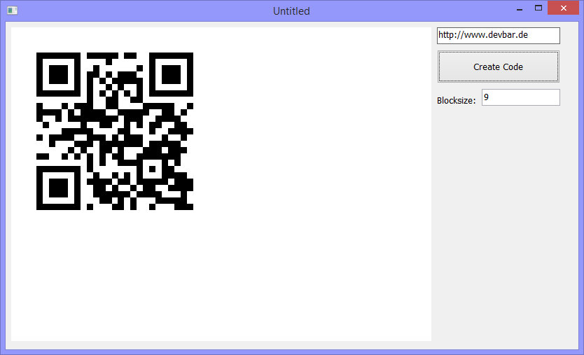

# PB-QrCode
This is an adaption of the simple QrCoder module (originally created by Raffael Herrmann) for PowerBuilder.

## Legal information and credits
QRCoder is project by [Raffael Herrmann](http://raffaelherrmann.de) and was first released 
in 10/2013. It's licensed under the MIT license.

## Open Source
   